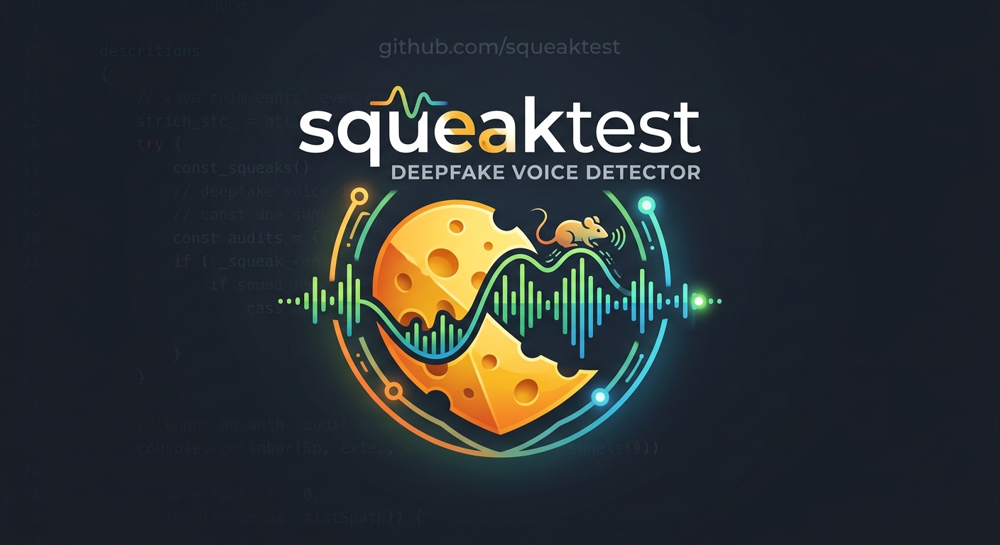

# squeaktest



> Real curds squeak. Fakes don't.

**squeaktest** estimates whether speech in an audio clip is synthetic (AI-generated or voice-cloned). Instead of a yes/no verdict, it gives a score and one of three bands (*Likely synthetic*, *Uncertain*, *Likely genuine*), and shows which parts of the clip look suspicious. Its accuracy is measured on audio and generators it wasn't trained on, and all results are published, including the weak ones. Voice counts as biometric data, so uploads are processed in memory, never stored, and never logged. It runs locally through a CLI or Docker, or on the web.

## Status

Early development. The command-line tool works (Phase 1), and its accuracy has been measured on data it was never trained or tuned on (Phase 2): see [Results](#results) and [Known gaps](#known-gaps). A web app comes next (Phase 3).

The research behind the model and dataset choices is in [docs/research.md](docs/research.md). Every design choice, with its effect on missed fakes and false positives, is in [docs/decisions.md](docs/decisions.md). What the model is for, and what it isn't, is in the [model card](docs/model-card.md).

## Usage

```bash
uv run squeaktest fetch-model             # one-time: download the model (1.27 GB, asks first)
uv run squeaktest analyze voicemail.m4a   # human-readable result and timeline
uv run squeaktest analyze voicemail.m4a --json
```

The result is a band (*Likely synthetic*, *Uncertain*, *Likely genuine*, or *Not assessed* when
there isn't enough sound), a score from 0 to 1, and a per-window timeline showing where the
suspicious parts are. The score is the model's raw output, not a probability; the band is what
to act on ([D16](docs/decisions.md), [D18](docs/decisions.md)). Opus files, common for voice
notes, get a warning, because Opus is the model's weakest condition ([K2](#known-gaps)). Output
never includes the file's name, so it is safe to log.

Exit codes: `0` analysis finished, `1` input rejected, `2` setup problem (for example, the
model hasn't been downloaded).

Speed, measured on one machine: about 1 second per minute of audio on an RTX 3050 GPU, and
15-28 seconds on CPU ([D15](docs/decisions.md), [D17](docs/decisions.md)).

## Results

Measured by squeaktest on [In-the-Wild](https://huggingface.co/datasets/mueller91/In-The-Wild), real and deepfake speech of public figures that the model never saw in training. Only the 43 test speakers count here; the other 11 speakers were used for every choice (thresholds, minimum length), so these numbers weren't tuned on. The phone and compression rows re-encode the test clips the way a SOC would receive them.

| Audio | EER | Fakes caught at 1% false positives | Genuine rated *Likely synthetic* | Fakes rated *Likely genuine* |
|---|---|---|---|---|
| Clean | 1.3% | 98.3% | 0.1% | 1.8% |
| Landline (G.711, 8 kHz) | 2.3% | 96.1% | 0.1% | 3.5% |
| Mobile (AMR-NB) | 4.3% | 90.3% | 0.3% | 3.3% |
| Voice note or VoIP (Opus, 12 kbit/s) | 6.1% | 73.7% | **8.6%** | 1.5% |
| Compressed (MP3, 32 kbit/s) | 2.2% | 95.9% | 0.1% | 3.6% |

EER is the error rate where false alarms and missed fakes are equally common; lower is better. The rest of each flagged or cleared share falls in *Uncertain*.

**What an alert means.** The test set is 38% fake, but a real voicemail queue is almost all genuine. If 1 recording in 1,000 were fake, about 58% of *Likely synthetic* results on clean audio would be real fakes (95% interval 36-100%), and about 1% on Opus audio. Opus voice notes are the weak spot.

**Read this as a best case.** In-the-Wild was published in 2022. On deepfakes that circulated online in 2024 ([Deepfake-Eval-2024](https://arxiv.org/abs/2503.02857)), NII reports 33% EER for these same weights. squeaktest hasn't measured that set yet (access is gated).

Intervals, per-condition details and the other models are in the [model card](docs/model-card.md), the [full report](eval/results/antideepfake-w2v-large/report.md) and the [bake-off](eval/results/bakeoff.md).

## Known gaps

Measured weaknesses and untested areas. Details are in [docs/decisions.md](docs/decisions.md#known-gaps).

- **Opus voice notes and VoIP audio** (K2): 8.6% of genuine Opus clips are rated *Likely synthetic*. squeaktest warns when the file is Opus, but not when the audio was Opus before being converted.
- **Very short clips** (K3): 5.1% EER for clips under 2 seconds. Clips with under 1 second of sound aren't scored at all.
- **Tones, beeps and music** (K1): non-speech audio can score as confidently synthetic. Not yet measured or fixed.
- **Recent real-world deepfakes:** probably much worse than the table above (see *Read this as a best case*).
- **Languages other than English:** untested.
- **Untested:** partial fakes (a cloned sentence spliced into a real call), real phone networks (the codecs above are simulated), and deliberate evasion.

## Model

| Model | Source (pinned) | License | How it's checked |
|---|---|---|---|
| AntiDeepfake Wav2Vec2-Large, by NII's Yamagishi Lab (default) | [`nii-yamagishilab/wav2vec-large-anti-deepfake`](https://huggingface.co/nii-yamagishilab/wav2vec-large-anti-deepfake/tree/7ccfcbb27d3098dafeb67596d4bb26e51e4627fc) at commit `7ccfcbb` | CC BY-NC-SA 4.0 (non-commercial) | SHA-256 verified on every load. Outputs match NII's original code within 7e-6 (logits) |
| AntiDeepfake MMS-300M (evaluation only) | [`nii-yamagishilab/mms-300m-anti-deepfake`](https://huggingface.co/nii-yamagishilab/mms-300m-anti-deepfake/tree/7928e119e09f616b2ce698892e00ca22dbaa40bf) at commit `7928e11` | CC BY-NC-SA 4.0 (non-commercial) | Same checks; within 4e-5 |
| AntiDeepfake Wav2Vec2-Small (evaluation only) | [`nii-yamagishilab/wav2vec-small-anti-deepfake`](https://huggingface.co/nii-yamagishilab/wav2vec-small-anti-deepfake/tree/9a13264b5dcc827a8d5a4f8e01fccefa392f886b) at commit `9a13264` | CC BY-NC-SA 4.0 (non-commercial) | Same checks; within 7e-6 |

squeaktest runs the models with Hugging Face `transformers` rather than NII's fairseq-based code; [docs/decisions.md](docs/decisions.md) (D8) explains why and how the two were compared. Wav2Vec2-Large became the default in the Phase 2 bake-off ([D17](docs/decisions.md), [eval/results/bakeoff.md](eval/results/bakeoff.md)). Weights are downloaded on request into `SQUEAKTEST_DATA_DIR`, never committed.

The evaluation data: [In-the-Wild](https://huggingface.co/datasets/mueller91/In-The-Wild) (CC BY-SA 4.0), and [ASVspoof 2019 LA](https://datashare.ed.ac.uk/handle/10283/3336) through a Hugging Face mirror checked file by file against the official archive (`scripts/verify_asvspoof_mirror.py`). Both are fetched by script, never committed.

## Development

You need [uv](https://docs.astral.sh/uv/) and [ffmpeg](https://ffmpeg.org/) (including `ffprobe`) on your PATH.

```bash
uv sync          # create the virtual environment from uv.lock
uv run pytest    # run the tests
```

Test audio is synthetic (tones generated by ffmpeg at test time). The repository never contains real voice recordings.

## License

Code: [MIT](LICENSE). The model weights are licensed separately by NII for non-commercial use only (CC BY-NC-SA 4.0), so squeaktest as a whole is a non-commercial project.
