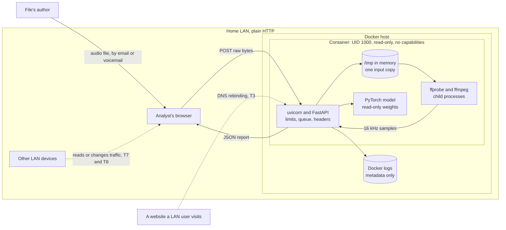

# Threat model: the web app, self-hosted on a home LAN

First version, 2026-10-19 (Phase 3). It covers squeaktest's web app running in Docker on one
machine in a home network, the deployment chosen in [D27](decisions.md). Claims are tied to the
code, the tests that check them, or a measurement. Anything that isn't is marked *unverified*.

## Scope and assumptions

**In scope:** the upload pipeline from the browser to the result: the HTTP server, the
analysis queue, decoding with ffmpeg, the model, the page, the container, and how the image is
built.

**The deployment assumed here:**

- One x86 Linux host on the home LAN runs the container with `compose.yaml`'s restrictions: UID
  1000, read-only root filesystem, `/tmp` in memory, no Linux capabilities, no privilege
  escalation, 2 CPUs, 6 GB of memory, 256 processes.
- The port is published on the host's LAN address only. *Not yet possible:* `compose.yaml`
  binds `127.0.0.1` today, so this needs a listen-address option (planned with the homelab
  setup).
- No reverse proxy and no TLS: plain HTTP on the LAN. `SQUEAKTEST_PROXY_HOPS` stays 0 and
  `SQUEAKTEST_FRAME_ANCESTORS` stays `'none'`. `SQUEAKTEST_ALLOWED_HOSTS` lists the name or
  address the host is reached by.
- No accounts: anyone who can reach the port can use it.
- The image is built from this repository on the host, either with the model inside
  (`WEIGHTS=included`) or with it mounted read-only.
- It's used for testing, with synthetic audio or recordings Dylan has the right to use.

**Out of scope:** the command-line tool (the README's
[How your audio is handled](../README.md#how-your-audio-is-handled) covers it), public hosting
(off for now, D27), the SIEM event (Phase 5), and deliberate evasion of the detector (Phase 5;
see [Evasion and misuse of the score](#evasion-and-misuse-of-the-score)).

## What needs protecting

| Asset | Why it matters |
|---|---|
| Uploaded audio | A voice identifies a person, and a voicemail's content can be sensitive too (names, account numbers). Confidentiality. |
| Results | They drive a triage decision, so a changed result does damage (integrity). They also reveal which recordings were checked (confidentiality). |
| The Docker host and the LAN behind it | What an attacker who gets code running in the container would go after next. |
| The model and the image | A tampered model gives wrong answers with no error. A tampered image runs someone else's code. |
| Availability | A homelab service being down costs little, so this ranks last. |

## Who might attack

- **The file's author.** Someone who sends a voicemail or voice note, controls every byte of the
  file, and never touches the LAN. The analyst carries the file in. This is the most important
  actor: squeaktest's whole job is opening files from suspected attackers, so "LAN only" never
  means "trusted input".
- **A website someone on the LAN visits.** Its scripts run in that person's browser, inside the
  LAN. They can send cross-site requests and try DNS rebinding.
- **Another device on the LAN.** A guest's phone, a smart TV, a compromised PC. It can reach the
  port directly, and on plain HTTP it can watch or change traffic if it gets into the path
  (ARP spoofing, for example).
- **The supply chain.** The Python base image (Docker Hub), the uv image (GitHub's container
  registry), Python packages (PyPI and PyTorch's index), Debian's package archive, the model
  repository on Hugging Face, and GitHub Actions.
- **The operator's own mistakes.** A wrong proxy hop count, a port exposed beyond the LAN, an
  image left unpatched.

## How data flows

**Trust boundaries**, where data crosses from less trusted to more trusted:

1. **LAN to the container's port.** Anything on the LAN can connect, including a browser being
   driven by a website (T3, T4, T9-T11).
2. **The app to ffmpeg.** The upload's bytes are parsed for the first time here, by C code with
   a long history of security bugs. This is the main attack surface (T1, T2).
3. **The container to the host kernel.** What stops code running in the container from
   reaching the host and the LAN (T1, T16).
4. **The internet to the image, at build time.** Base images, packages and the model come in
   here (T15).

**Where an upload exists, and for how long:** in the server's memory while it arrives and waits
(one analysis runs at a time, up to 4 more wait). During decoding, one copy sits in a private
temporary folder under `/tmp`, which `compose.yaml` keeps in memory, so it never reaches the
disk. The folder is deleted when decoding ends, whether it worked or not. The decoded samples
stay in memory until the response is sent. Nothing is written anywhere else.

## Threats

Residual risk is rated for this deployment, after the controls that exist today.

| ID | Threat | Status | Residual risk |
|---|---|---|---|
| T1 | A crafted file exploits ffmpeg and runs code in the container | Partly mitigated | **Medium** |
| T2 | A crafted file exhausts CPU or memory while decoding | Mitigated, tested | Low |
| T3 | A website uses DNS rebinding to drive squeaktest from a LAN browser | Mitigated, tested | Low |
| T4 | A website sends uploads cross-site (CSRF) | Mitigated, tested | Low |
| T5 | The page is framed or injected with script | Mitigated, tested | Low |
| T6 | Logs, errors or caches leak audio or who uploaded it | Mitigated, tested | Low |
| T7 | A LAN device reads uploads and results in transit | Accepted for testing | Medium with real recordings |
| T8 | A LAN device changes a result in transit | Accepted for testing | Medium with real recordings |
| T9 | Anyone on the LAN uses the service | Accepted | Low |
| T10 | A client dodges the rate limit with a forged address | Mitigated, tested | Low |
| T11 | Slow or numerous connections lock others out | Mostly mitigated | Low |
| T12 | Memory runs out under load and the service stays down | Partly mitigated | Low |
| T13 | An upload is left behind on disk | Mitigated, tested | Low |
| T14 | Tampered model weights | Mitigated, tested | Low |
| T15 | A tampered or vulnerable dependency in the image | Partly mitigated | Low to medium |
| T16 | Code escapes the container to the host | Docker's defaults | Low |

### T1. A crafted file exploits ffmpeg

*Who:* the file's author. *What they get:* code running as UID 1000 inside the container.

A memory-safety bug in one of the demuxers or decoders squeaktest allows would let a file run
code inside ffprobe or ffmpeg. That's the most valuable attack on squeaktest, and the file's
author only needs someone to upload the file.

**Controls:**
- The container format is identified from the file's first bytes, and ffmpeg is forced to use
  that demuxer, so it never guesses. That keeps out playlist formats (HLS, concat) that can pull
  in other files. Tested: `tests/test_audio.py::test_sniff_rejects_everything_else`,
  `::test_extension_is_ignored`.
- ffmpeg is told which decoders it may open (`-codec_whitelist`), and they are only the ones
  for the allowed codecs. Files with cover art or a second stream are refused before any other
  decoder runs (D26). Tested: `::test_ffmpeg_is_told_which_decoders_it_may_open`, plus the
  `mp3_cover`, `m4a_cover` and `m4a_two_streams` cases in `::test_disallowed_formats_are_rejected`.
- ffmpeg may only read local files (`-protocol_whitelist file`), so a file can't make it open a
  network connection.
- Decoding runs in a separate process with one thread, and is killed after 30 s.
- In the container the app is UID 1000, with no capabilities and no privilege escalation, and
  everything but `/tmp` is read-only. Its code and model are owned by root, so even UID 1000
  can't change them. Checked on every push by `scripts/check_image.sh`.
- ffmpeg comes from Debian's packages, which Debian's security team patches (7.1.5 at the
  first build).
- **Detection.** If ffprobe or ffmpeg is killed instead of exiting (a signal such as SIGSEGV or
  SIGABRT), the log line says `"outcome": "decoder_crashed"`, at WARNING, with the step and the
  return code (D29). Failed exploit attempts and fuzzing tend to crash the decoder, so a run of
  these is worth an alert. The uploader gets the same answer as for any unreadable file, so
  it's no help in tuning an exploit. Tested:
  `tests/test_audio.py::test_a_crashed_decoder_is_told_apart_from_a_bad_file`,
  `tests/test_api.py::test_a_decoder_crash_is_logged_apart_but_answered_like_a_bad_file`. An
  exploit that works doesn't crash anything, so this catches the attempts, not the success.

**What's left:**
- **Same user as the app.** The exploited process runs as UID 1000, like the server. It can
  start a background process that outlives the request (a timeout kills only the direct child).
  That process could then read every later upload as it passes through `/tmp`, until the
  container restarts. Depending on the host's ptrace setting (Yama), it might also read the
  server's memory, including uploads waiting in the queue. *Inferred from the design, not
  tested.*
- **Network access.** The container can reach the LAN and the internet, so exploit code could
  send uploads out or probe other machines on the LAN. The app needs no outbound network at
  runtime, but nothing blocks it.
- **Patching depends on rebuilding.** The image gets Debian's ffmpeg fixes only when it is
  rebuilt, and nothing does that automatically (D26).
- A bug in how ffmpeg enforces the whitelist itself would expose its other decoders.

**Would reduce it:** block outbound traffic from the container at the host firewall (Docker's
`DOCKER-USER` chain). Rebuild on a schedule, and as soon as an ffmpeg advisory affects an
allowed demuxer or decoder. Decode under a separate user or in a separate container with a
seccomp profile (a Phase 5 candidate, D26).

### T2. A crafted file exhausts CPU or memory while decoding

*Who:* the file's author. *What they get:* a slow or stuck service.

**Controls:**
- Files over 25 MB are refused: before reading if `Content-Length` says so, and as soon as the
  body passes the limit if it doesn't. Tested: `tests/test_api.py::test_declared_oversized_upload_is_refused`,
  `::test_oversized_upload_without_a_length_is_cut_off`, `::test_upload_reader_stops_at_the_limit`.
- Audio over the duration limit (5 minutes by default) is refused from the header. A header
  that lies doesn't help: ffmpeg stops 1 s past the limit (`-t`), and the decoded length is
  checked again. Tested: `tests/test_audio.py::test_header_duration_over_limit_is_rejected`,
  `::test_decoded_length_is_checked_even_if_the_header_hides_it`.
- Probing and decoding are each killed after 30 s. Tested: `::test_decoder_timeout`.
- One analysis at a time, on one worker thread, so a slow file delays the queue but doesn't
  multiply. Tested: `tests/test_api.py::test_queue_runs_one_at_a_time_and_refuses_when_full`.
- NaN and infinite samples are rejected, so they can't silently corrupt the model's output.

**What's left:** a single request can take up to 60 s of decoding plus the model's time (about
21 s per minute of audio on 2 CPUs, D27). ffmpeg's error output is collected in memory without
a cap, but `-loglevel error` keeps it small. Low on a LAN.

### T3. DNS rebinding from a website

*Who:* a website someone on the LAN visits. *What they get:* their script talks to squeaktest
as if it came from squeaktest's own page.

The attacker's domain first points at their own server, then at the homelab's LAN address.
The browser treats both as the same origin, so the script can post files and read the
responses. Browser same-origin rules, CORS and the content-type check don't stop this, because
from the browser's point of view nothing is cross-site.

**What it would gain:** no stored results to steal, because nothing is stored. But it would
give a website on the internet a way to deliver crafted files to the decoder (T1) without the
analyst uploading anything, and to use up the queue.

**Controls:**
- The browser still sends the attacker's host name in the `Host` header, so squeaktest answers
  only requests addressed to its loopback names (`localhost`, `127.0.0.1`, `::1`) or to a name
  the operator lists in `SQUEAKTEST_ALLOWED_HOSTS`. Anything else gets 400 before any route
  runs, so an upload is never read (D28). Tested:
  `tests/test_api.py::test_other_host_names_are_refused`,
  `::test_a_rebound_upload_is_refused_and_logged_without_the_name`,
  `::test_loopback_names_are_always_answered`, `::test_listed_names_are_answered`.
- Each refusal leaves one metadata-only log line (`"outcome": "wrong_host"`). A run of them
  from an otherwise quiet LAN service is worth an alert.
- The rate limit still applies, keyed on the LAN browser's address. Some browsers now ask
  before a public site can reach a local address; squeaktest doesn't rely on that.

**What's left:** an operator who lists a name an attacker controls would undo it. A live
rebinding attack wasn't tried; the check was tested through the app and with `curl` against a
running server.

### T4. Cross-site uploads (CSRF)

*Who:* a website someone on the LAN visits.

**Controls:**
- Uploads must be `application/octet-stream`. A browser won't send that cross-site without
  first asking permission (a CORS preflight), and squeaktest never grants it. Tested:
  `tests/test_api.py::test_there_is_no_cors`.
- Requests a browser *can* send cross-site without asking (`text/plain`, forms) get 415 before
  the body is read, so their bytes never reach the decoder. Tested:
  `::test_only_raw_octet_stream_uploads_are_accepted`.
- There are no cookies or logins for a forged request to ride on.

### T5. Framing and script injection

*Who:* a website, or a crafted file trying to inject script through the results.

**Controls:**
- The page can't be framed: CSP `frame-ancestors 'none'` and `X-Frame-Options: DENY`.
- Scripts, styles and requests are only allowed from squeaktest itself, with no inline code.
  Tested: `tests/test_api.py::test_csp_allows_only_this_origin_and_no_inline_code`,
  `::test_page_has_no_inline_code`, `::test_page_loads_nothing_from_other_origins`.
- The page writes every server value with `textContent` and builds the chart with DOM calls, so
  no response text is ever parsed as HTML. Tested: `::test_script_never_parses_server_text_as_html`.
- Every response carries the headers (`nosniff`, `no-referrer`, a restrictive
  `Permissions-Policy`, COOP and CORP). Tested: `::test_every_response_carries_security_headers`.
- The API documentation pages are off, since they load scripts from a CDN. Tested:
  `::test_api_docs_are_off`.

### T6. Leaks through logs, errors or caches

**Controls:**
- One log line per request: outcome, band, file size, audio length, codec and time taken (and
  for a decoder crash, the step and return code). Never the audio, a file name, the score or
  the client's address. Tested:
  `tests/test_api.py::test_logs_hold_metadata_only`.
- uvicorn's access log, which records addresses, is off, and so is its `Server` header. Tested:
  `::test_serve_runs_uvicorn_with_safe_options`.
- Error messages never include file names or content. Tested:
  `tests/test_audio.py::test_errors_do_not_leak_the_filename`,
  `tests/test_api.py::test_rejected_files_get_a_400_with_a_safe_message`. An unexpected error
  logs only the exception's type.
- Responses say `Cache-Control: no-store`, and the page sends no referrer.
- No analytics or telemetry. Hugging Face's libraries run offline in the container. Tested:
  `::test_no_telemetry_sdk_is_installed`.
- Client addresses are kept in memory only, for rate limiting, and forgotten within about two
  minutes (D25). Tested: `::test_rate_limiter_forgets_clients_once_their_limit_has_reset`.

**What's left:** Docker keeps the container's log on the host with no size limit by default.
It's metadata only, but it does show when the service was used.

### T7 and T8. Reading or changing traffic on the LAN

*Who:* a LAN device that gets into the traffic's path.

On plain HTTP, such a device can read every upload (T7), and change a result before the
analyst sees it (T8). For a triage tool, T8 is the worse one: a *Likely synthetic* turned into
*Likely genuine* sends a vishing call through as real.

**Controls today:** none; this deployment has no TLS. Switched networks and Wi-Fi encryption
make it harder, but don't stop a device that spoofs its way into the path.

**Accepted** for testing with synthetic audio or recordings of no value. **Before real
recordings:** put a reverse proxy with TLS in front, set `SQUEAKTEST_PROXY_HOPS=1`, and check
that the rate limit then sees each client's own address (D25's hop count is still unverified
behind a real proxy).

### T9. Anyone on the LAN can use it

There are no accounts. Anyone who can reach the port can upload files, which also means they
can reach the decoder (T1).

**Controls:** the port is published on the LAN address only (once that option exists). Each
client gets one analysis at a time and 6 requests a minute, and the queue refuses more than 4
waiting. Tested: `tests/test_api.py::test_clients_are_rate_limited`,
`::test_a_client_gets_one_analysis_at_a_time`.

**Watch for:** Docker's published ports go around host firewalls like `ufw`, so a port
published on every address (`0.0.0.0`) is reachable even if the firewall says otherwise. Publish
on the LAN address explicitly, and never forward the port on the router.

**Accepted** for a home network. To narrow it, allow only the analyst's devices to reach the
port, or put the host on its own VLAN.

### T10. Forged addresses to dodge the rate limit

**Controls:** with `SQUEAKTEST_PROXY_HOPS=0`, `X-Forwarded-For` is ignored and the client is
whoever connected. uvicorn's own proxy-header handling is off. Tested:
`tests/test_api.py::test_forwarded_addresses_are_ignored_without_trusted_proxies`,
`::test_serve_runs_uvicorn_with_safe_options`.

**What's left:** a hop count set higher than the real number of proxies lets clients choose
their address (D25). It's an operator mistake; the README's settings table warns against it.

### T11. Slow or numerous connections

**Controls:**
- An upload must finish within 60 s. Tested: `tests/test_api.py::test_slow_uploads_time_out`.
- At most 32 open connections; uvicorn answers 503 beyond that.
- A full queue gets an immediate 503 instead of holding the upload. Tested:
  `::test_queue_runs_one_at_a_time_and_refuses_when_full`.

**What's left:** the 60 s limit starts once the headers are in. As far as we know, uvicorn has
no limit on how slowly a client sends its headers, so one device holding 32 slow connections
could lock everyone else out until it stops. *Unverified.* Low on a LAN, where the culprit is
easy to find.

### T12. Running out of memory

The worst case is about 800 MB of uploads arriving (32 connections at 25 MB), 125 MB queued
(5 at 25 MB), and the model's 2.84 GB peak (measured, D27): about 3.8 GB, under the 6 GB limit.
*Estimated, not measured under load.*

**What's left:** if the container is killed for running out of memory, `compose.yaml` has no
restart policy, so it stays down. **Would fix it:** `restart: unless-stopped`.

### T13. Uploads left on disk

**Controls:** the copy for ffmpeg goes in a private temporary folder under a fixed name, which
is deleted whether decoding works or not. Tested:
`tests/test_audio.py::test_temp_files_are_always_deleted`. In the container, `/tmp` is in
memory, so even a crash mid-decode leaves nothing on the host's disk, and the folder is gone
when the container stops.

### T14. Tampered model weights

**Controls:** the model is pinned to a Hugging Face commit, and its SHA-256 is checked at build
time and again on every load, so a changed file fails loudly. Tested:
`tests/test_model.py::test_weights_must_match_the_published_checksum`. The weights are
safetensors, which hold numbers only: loading them can't run code, unlike PyTorch's
pickle-based formats (D13).

**What's left:** the checksum proves the file is the one NII published, not that NII's model is
free of a backdoor. squeaktest's own evaluation (Phase 2) is the check on its behaviour.

### T15. A tampered or vulnerable dependency in the image

**Controls:**
- The Python and uv base images are pinned by digest, so a moved tag can't change the build.
- Python packages are installed exactly as `uv.lock` pins them (`--locked`). CI audits every
  locked package for known vulnerabilities, PyTorch included, and runs Bandit on the code.
- GitHub Actions are pinned to commit hashes, and the workflows' token can only read.

**What's left:**
- Debian's packages (ffmpeg and its libraries) aren't pinned: each build installs whatever is
  current. That brings in security fixes, but builds aren't reproducible, and nothing scans the
  image's OS packages for known vulnerabilities.
- Digest bumps and rebuilds are manual (D26).
- The homelab builds the image from source, so there's no signed image to check.

**Would reduce it:** scan the image in CI (Trivy or Grype, for example), rebuild on a schedule,
and publish a signed image with a software bill of materials that the homelab checks before
running it.

### T16. Escaping the container

*Who:* anyone who already has code running in the container (T1).

**Controls:** the user isn't root, has no capabilities and can't gain privileges. Docker's
default seccomp profile applies, and so does its AppArmor profile on hosts that have AppArmor,
since `compose.yaml` turns neither off. The Docker socket isn't mounted, and the only host
folder mounted is the model, read-only.

**What's left:** the container shares the host's kernel, so a kernel bug could still break out.
Keep the host patched.

## Evasion and misuse of the score

squeaktest is a detection control, so the other way to attack it is to make it give the wrong
answer. The full analysis is planned for Phase 5. Known so far:

- **Missed fakes.** On deepfakes that circulated in 2024, NII reports 33% EER for these weights.
  Opus voice notes are the weakest condition squeaktest measured (README, Known gaps). An
  attacker who knows this can choose a generator or a channel that scores *Likely genuine*.
- **Genuine audio made to look fake.** Tones and music can score as confidently synthetic (K1).
  Padding a genuine recording with hold music could push it towards *Likely synthetic* and
  discredit real evidence. *Not measured.*
- **Treating the band as a verdict.** Every result carries a disclaimer, the score is labelled
  as uncalibrated, and Opus files get a warning. None of that stops an analyst trusting it too
  much; how the result is used is up to the SOC's process.

## What would reduce the risk most

In order of value for effort:

1. ~~**Check the `Host` header** (T3).~~ Done on 2026-10-19 (D28): it closed the one way an
   internet site could reach the decoder.
2. **Block the container's outbound traffic** at the host firewall (T1). Host configuration
   only; the app needs no network at runtime.
3. **Add a restart policy and a LAN listen address to `compose.yaml`** (T9, T12). Part of the
   homelab setup.
4. **Scan the image and rebuild it on a schedule** (T1, T15). A CI job.
5. **TLS through a reverse proxy before real recordings** (T7, T8). Homelab setup, then verify
   the proxy hop count.
6. **Decode in a separate sandbox** (T1). The biggest change; a Phase 5 candidate.

## What's verified and what isn't

- **Tested on every push:** the controls cited with test names above (`uv run pytest`), and the
  image's own hardening (`scripts/check_image.sh`: UID 1000, read-only code and model, starts
  with no capabilities on a read-only filesystem).
- **Measured once:** the image with the model inside, running under `compose.yaml`'s
  restrictions: 2.84 GB peak memory, about 21 s per 60-second clip (D27).
- **Unverified:**
  - `docker compose up` itself.
  - That a real decoder crash reaches the log as `decoder_crashed` inside the container. The
    tests simulate the crash's return code rather than crashing ffmpeg.
  - The LAN listen address, which doesn't exist yet.
  - What exploit code could reach as UID 1000 (T1).
  - How uvicorn handles slow headers (T11).
  - Memory use under full load (T12).
  - A live DNS rebinding attack (T3). The `Host` check that stops it is tested.

## Revisit when

- The service is reachable from outside the LAN. That needs TLS, accounts or an allowlist of
  clients, a verified proxy hop count, its public name in `SQUEAKTEST_ALLOWED_HOSTS`, and a new
  look at D27.
- squeaktest starts storing anything: results, uploads or a history.
- A new format or codec is allowed, which means new decoders in reach.
- The SIEM event (Phase 5) adds identifiers to the output.
- A model ships in a pickle-based format (`.pt`, `.bin`, `.pth`) instead of safetensors.
